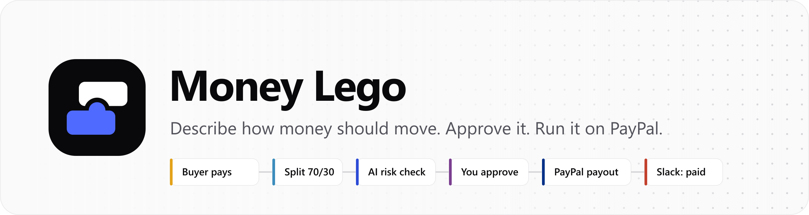
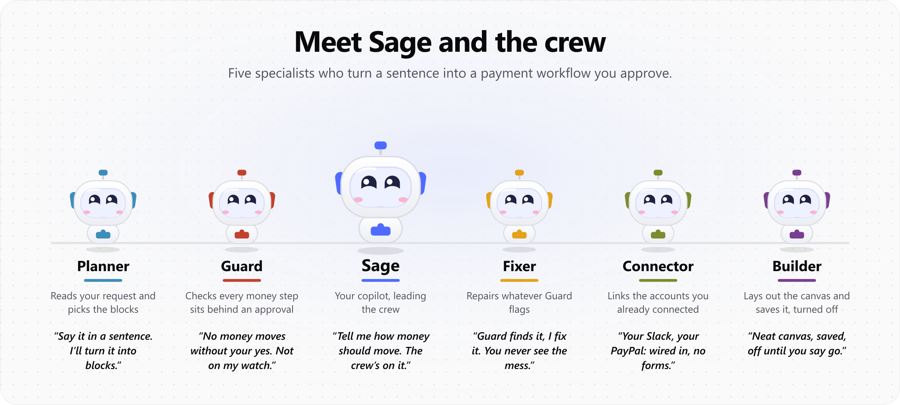
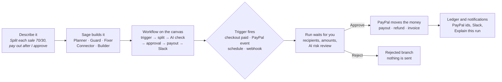
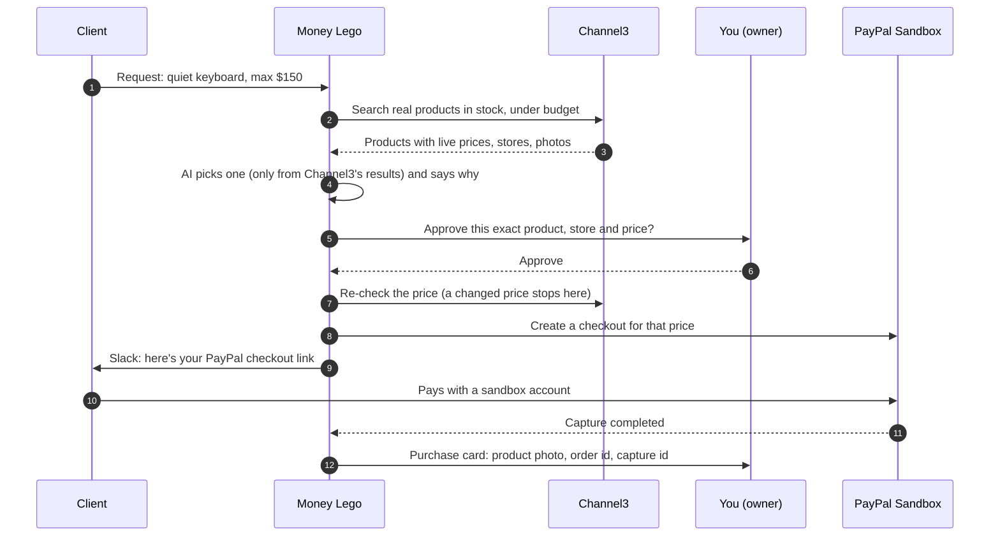

<p align="center">
  
</p>

<p align="center">
  <b>Payment operations you describe in a sentence, approve with confidence, and run on PayPal.</b><br />
  <sub>Built on the PayPal Developer Platform. Runs on the PayPal Sandbox: real PayPal APIs, test accounts, test money.</sub>
</p>

<p align="center">
  <a href="LICENSE"></a>
  <a href="#try-it"></a>
  
</p>

<p align="center">
  <a href="#the-problem">Problem</a> ·
  <a href="#what-money-lego-does">Product</a> ·
  <a href="#meet-sage-and-the-crew">Meet the crew</a> ·
  <a href="#how-it-works">How it works</a> ·
  <a href="#use-case-ai-product-sourcing-with-channel3">Channel3 use case</a> ·
  <a href="#the-payments-dashboard-ag-grid-and-ag-studio">AG Studio dashboard</a> ·
  <a href="#money-lego-on-astropods">Astropods</a> ·
  <a href="#runs-on-the-paypal-sandbox">PayPal Sandbox</a> ·
  <a href="#built-with">Built with</a> ·
  <a href="docs/TECHNICAL_SPEC.md">Technical spec</a> ·
  <a href="#license">License</a>
</p>

---

## The problem

Small agencies, creators and online sellers move money every week in ways their tools don't understand:

- **"When a client pays, split it 70/20/10 and pay everyone."** Today that's a calculator, three PayPal payouts by hand, and a Slack message, with nothing to show who approved what.
- **"Chase the invoices that are overdue."** Someone exports a list, writes reminders one by one, and forgets the ones that slipped.
- **"Find the right product for a client, get it approved, get paid."** That's browsing stores, comparing, sending links and chasing the payment.

Automation tools can do parts of this, but they move money on autopilot. When the money is real, owners want automation **and** the final say. Developers who could build it end up maintaining fragile webhook scripts.

## What Money Lego does

Money Lego turns a payment process into a **workflow you can see, check and approve** before any money moves.

1. **Describe it.** Type what should happen. **Sage**, the AI copilot, and its crew (Planner, Guard, Fixer, Connector, Builder) build the workflow block by block while you watch.
2. **Inspect it.** The workflow is a visual canvas of real blocks: PayPal triggers, exact splits, AI checks, approvals, payouts, Slack messages. Change anything, or ask Sage to.
3. **Approve it.** Every payout, refund or invoice send pauses for you. You see exactly who gets what, with an AI risk review, and you can approve from any page through the notification bell.
4. **Run it.** The workflow runs on PayPal: checkout, capture, payout, status follow-up and notifications. Every PayPal id is recorded, and any run can be explained in plain words.

**Who it's for**

- **Agencies and studios:** split client payments with collaborators, invoice clients, source products for clients.
- **Creators:** share sales revenue with partners after a quick review.
- **Small online businesses:** chase late invoices, recover failed subscriptions, keep a clean money ledger.

**Highlights**

- **Money never moves without you.** AI drafts and explains, but every payout, refund and invoice send waits for a human approval. The approval is fingerprinted: if an amount or recipient changes after you approve, the action refuses to run.
- **Exact to the cent.** Splits are calculated in whole cents and always add up; a leftover cent is assigned visibly, never lost.
- **A checkout page for every workflow.** Each workflow can have its own hosted PayPal checkout. When a buyer pays, the run starts on its own.
- **Approvals follow you.** A bell and a corner notice bring every waiting approval to whatever page you're on, sorted by what expires first.
- **A ledger you can trust.** The Payments page shows Captured, Paid out, Refunded and Net, and every number opens up to the PayPal ids behind it.
- **Work as a team.** Share a workflow to view or to edit, or hand it over. Only the owner runs it, so nobody spends someone else's PayPal.
- **Explain any run.** One click turns a run's record into a plain-language summary: what happened, whether money moved, what to do next.

**Ready-made templates**

| Template | Flow |
| --- | --- |
| PayPal Sale → Revenue Split Payout | Buyer pays your checkout → split the net → AI risk check → you approve → PayPal payouts → Slack |
| AI Invoice Reminder Assistant | Every Monday: overdue invoices → AI drafts a reminder each → you review → PayPal sends them |
| Failed Subscription Payment Recovery | Failed payment → AI explains why → alert the team → catch-up invoice you approve |
| Approved Refund Desk | Refund request → AI check → you approve → refund once per capture |
| Weekly PayPal Ops Digest | Every Friday: AI summary of the week's transactions → Slack |
| AI Product Sourcing → PayPal Checkout | Request → Channel3 products → AI pick → you approve → checkout link → buyer pays |

## Meet Sage and the crew

<p align="center">
  
</p>

When you describe a workflow, you watch this crew build it live: each bot lights up while it works, hands off to the next, and the blocks appear on the canvas as they agree on them.

| Bot | Job | In its own words |
| --- | --- | --- |
| **Sage** | Your copilot. Takes your request and leads the crew. | "Tell me how money should move. The crew's on it." |
| **Planner** | Reads the request and picks the blocks and wiring. | "Say it in a sentence. I'll turn it into blocks." |
| **Guard** | Checks every money step sits behind an approval, and health-checks settings, accounts and recent runs. | "No money moves without your yes. Not on my watch." |
| **Fixer** | Repairs whatever Guard flags that doesn't need your input. | "Guard finds it, I fix it. You never see the mess." |
| **Connector** | Links the accounts you already connected (Slack, PayPal and more). | "Your Slack, your PayPal: wired in, no forms." |
| **Builder** | Lays out the canvas in the order money flows and saves it, turned off. | "Neat canvas, saved, off until you say go." |

In the editor, the same crew sits in the Sage panel: ask a question in words, or tap one bot to have it do its one job on the open workflow.

## How it works



1. **Start from a sentence or a template.** Sage drafts the workflow using only real, registered blocks. Guard checks that every money step sits behind an approval before anything is saved.
2. **Connect your accounts.** Slack, Discord, Telegram, Google Sheets, Airtable, Notion, GitHub and Shopify connect with one sign-in each. PayPal is the payment backbone.
3. **Turn it on.** A checkout page, a PayPal event, a schedule or a signed webhook starts each run.
4. **Approve and watch.** Approvals reach you on any page. The run panel shows every step and every PayPal id.

## Use case: AI product sourcing with Channel3


An agency gets a request from a client: *"A quiet mechanical keyboard for our studio, under $150."* With Money Lego and [Channel3](https://channel3.ai), the whole purchase runs as one approved workflow, and the AI can only work with real products and real prices.



### How Channel3 search is used

| Where | What it does with Channel3 |
| --- | --- |
| **Channel3 product search** block (`shop.search`) | Calls Channel3's `/v1/search` with the request text (usually `{{ trigger.request }}`), the budget as a price cap, and how many results to return. Only new, in-stock products come back, each with title, brand, photo, price, store, stock and buy link. |
| **AI pick product** block (`ai.pick`) | Reads those results and picks one, with a reason. The pick is checked against the returned ids, and its price, brand and stock are copied from Channel3, not written by the model. |
| **PayPal checkout link** block | After you approve, looks the product up again with Channel3's `/v1/products/{id}`. If the price or stock changed, it stops; otherwise it creates the PayPal order at that price. |
| **Purchase card** in the run panel | Fetches the product live by id to show its current photo, rating, stock and key features next to the price that was actually paid. |
| **Money Lego assistant** | Can search Channel3 products in chat when you ask what's available. |

Channel3's API key stays on the server; the browser and the AI only ever see the normalised product data.

What makes it trustworthy:

- **Grounded AI.** The pick must be one of the products Channel3 returned (checked by id). Price, brand and stock always come from Channel3, never from the model.
- **The price you approved is the price charged.** The product is re-read from Channel3 after approval; if the price moved, no checkout is created.
- **Conditions route the work.** A typical sourcing workflow tags finance in Slack when the pick is over $100 and ops when it's under, and tags sourcing if Channel3 finds nothing.
- **See what was bought.** The run panel's Purchase card shows the product photo, store, rating, the price paid, and each step from your approval to the buyer's payment, with PayPal ids.

Channel3 doesn't place merchant orders yet (its checkout API is announced as coming soon), so the business remains the merchant of record and fulfilment is its own step.

## The Payments dashboard: AG Grid and AG Studio


The **Payments** page is where an owner checks the money. It has three tabs.

| Tab | Built with | What you get |
| --- | --- | --- |
| **Dashboard** | **AG Studio** | A ready-made report over every PayPal object and every workflow run: Captured, Paid out, Refunded, Payout problems, Runs succeeded and Runs failed as tiles; volume by PayPal object, captured over time and runs by status as charts; and the PayPal ledger as a table. Clicking any chart filters the rest of the page. |
| **PayPal objects** | **AG Grid** | Every order, capture, refund, payout batch and item, invoice and subscription, with type filter and search |
| **Workflow runs** | **AG Grid** | Every run with its status, trigger, duration and error, searchable |

How AG Studio is wired in:

- **Two data sources.** Money Lego hands AG Studio two tables: *PayPal objects* and *Workflow runs*. They come with ready measure columns (captured, paid out, refunded, payout problems, succeeded, failed), so every tile is a plain sum and needs no setup.
- **Customise it.** **Customize dashboard** opens AG Studio's editor full screen: drag widgets and fields, add pages, change charts. The layout is saved in your browser, and **Reset** brings back the default report.
- **Ask it in words.** AG Studio's own AI agents can build pages from a sentence, with starters such as *"Build a payouts page: total paid out, payout problems, paid out by workflow, and a ledger of payout items"*, *"Show captured revenue by week and by workflow"* and *"Add a page for workflow run health"*. Their model calls go through Money Lego's server (`/api/studio/llm`), so no AI key reaches the browser, and the agents can only change the dashboard, never PayPal or a workflow.
- **Every number explained.** Above the dashboard, a summary row shows Captured, Paid out, Refunded and Net kept; each opens to the PayPal ids, workflows and runs that add up to it.

## Money Lego on Astropods

The **Money Lego assistant** also runs outside the app, as a chat agent on [Astropods](https://astropods.com): blueprint **[`krish/money-lego`](https://astropods.com/krish/money-lego)** (public).

It's the same assistant as the in-app chat, with the same crew behind it, so you can manage PayPal operations from a conversation:

| Ask | It does |
| --- | --- |
| "Which invoices are unpaid?" | Looks it up in PayPal through PayPal's official **Agent Toolkit** (read-only: invoices, orders, refunds, disputes, subscriptions, transactions) |
| "Why did last night's payout fail?" | Reads the run history and explains it |
| "How much did we capture and pay out this week?" | Summarises the Money Lego ledger |
| "Every Monday, remind clients about overdue invoices after I approve" | Sage's crew drafts the workflow and saves it turned off, with a link to open it in the app |

It never moves money itself: anything that would move money becomes a workflow step that waits for an approval in the app. Each deployment acts as one Money Lego account and sees only that account's workflows, runs and PayPal objects. Deployment steps are in the [technical spec](docs/TECHNICAL_SPEC.md#astropods-deployment).

## Runs on the PayPal Sandbox


Money Lego calls the **real PayPal REST APIs** in PayPal's **Sandbox** environment. Every order, capture, payout, refund and invoice is a real PayPal object with a real id. The accounts and the money are test ones.

| PayPal product | Used for |
| --- | --- |
| Orders v2 + JS SDK | Hosted checkout pages and checkout links; the server sets the price and captures it |
| Payouts v1 | Paying recipients after approval, with item-level status follow-up |
| Invoicing v2 | Finding, creating, sending and reminding invoices |
| Payments v2 | Refunds, once per capture |
| Subscriptions v1 | Reading subscription status for recovery workflows |
| Transaction Search | Weekly digests and the ledger |
| Webhooks v1 | Verified events (signature checked) that start runs and update statuses |
| Agent Toolkit | The assistant's read-only PayPal agent |

**Testing it yourself:**

1. In [developer.paypal.com](https://developer.paypal.com) → Apps & Credentials → **Sandbox**, create a REST app and enable **Payouts**, **Invoicing** and **Transaction Search**.
2. Use a **US sandbox business account** for the app: PayPal refuses Payouts from some countries (for example India-registered apps return `PAYOUT_NOT_AVAILABLE`).
3. In Sandbox → **Accounts**, use a sandbox **personal** account to pay checkout pages, and sandbox emails (`sb-…@personal.example.com`) as payout recipients. A real email address isn't a sandbox account, so a payout to it stays `UNCLAIMED`.
4. Run `npm run paypal:check` to confirm the app works, then log into [sandbox.paypal.com](https://www.sandbox.paypal.com) as the recipient to see the money arrive.

Runs started with the editor's **Run** button use the trigger's test data and are labelled **TEST**; their PayPal steps still run against the sandbox.

## Built with

| | Partner | What it powers |
| :-: | --- | --- |
|  | **PayPal** | The payment backbone: Checkout, Payouts, Invoicing, Refunds, Subscriptions, Transaction Search, Webhooks and the Agent Toolkit |
|  | **Channel3** | Real product data for agentic commerce: search, product details, live price and stock |
|  | **AG Grid · AG Studio** | The Payments dashboard: KPI tiles, charts, the ledger and cross-filtering, customisable by drag and drop or by AG Studio's AI agents |
|  | **Elastic** | Full-text run search, and past failures that help "Explain this run" spot recurring problems |
|  | **Zapier** | A block that sends run data to a Zapier Catch Hook, reaching 8,000+ apps |
|  | **Slack** | Notifications with member tagging, per workflow branch |
|  | **OpenAI · OpenRouter** | OpenAI runs Sage, the assistant and the dashboard agents; OpenRouter runs small AI steps; each falls back to the other |

Also part of the stack: **Astropods** hosts the Money Lego assistant as a public chat agent, **Kinde** handles sign-in and accounts, with Money Lego email + password accounts as a fallback (setup and callback URLs: [docs/auth.md](docs/auth.md)), and **Postman** holds a collection of every PayPal call Money Lego makes (`postman/`).

## Try it

**Five-minute walkthrough:**

1. Sign up, open **Templates → PayPal Sale → Revenue Split Payout → Use template**.
2. In **Split allocation**, put sandbox personal account emails under Recipients. Turn the workflow **on**.
3. Open the workflow's **checkout page** and pay with a sandbox personal account.
4. The bell rings: **Review** the payout (recipients, amounts, AI risk check) and **Approve**.
5. Watch the payout land, then open **Payments** and click **How** on any total to see the PayPal ids behind it. Click **Explain this run**.
6. Ask Sage: *"When a PayPal subscription payment fails, explain why with AI, alert Slack, and draft a catch-up invoice I approve."*

**Run it locally:**

```bash
npm install
cp .env.example .env     # MongoDB, Kinde (optional, see docs/auth.md), PayPal sandbox, OpenAI/OpenRouter, Channel3
npm run paypal:check     # confirms your PayPal sandbox app
npm run dev              # http://localhost:3000
```

Architecture, data model, API reference and deployment: **[docs/TECHNICAL_SPEC.md](docs/TECHNICAL_SPEC.md)**.

## What's next

- Customers connect their own PayPal account (PayPal Partner onboarding) instead of one sandbox app.
- Placing the merchant order automatically once Channel3's checkout API ships.
- Dispute triage, scheduled payout windows, and more connectors.

## License

Money Lego is open source under the [MIT License](LICENSE): use it, change it and ship it, commercially or not, as long as the copyright notice stays with the code.

---

<p align="center">
  <br />
  <sub>Money Lego · <a href="LICENSE">MIT licensed</a> · PayPal Sandbox</sub>
</p>
